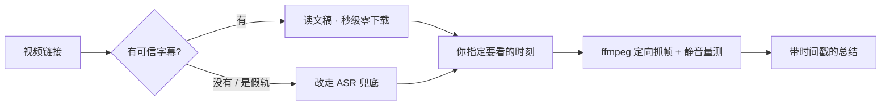

# pkkkkh 的 DSH 插件

[](https://github.com/pkkkkh/dsh-plugins-public/stargazers)
[](https://www.npmjs.com/package/@pkkkkh/dsh-restart)
[](https://www.npmjs.com/package/@pkkkkh/dsh-restart)
[](LICENSE)

给 **DeepSeek Harness**（DSH）用的 7 个小工具：让跑在 IM 通道（微信 / QQ / 飞书…）或桌面端的 agent，能**自己重启**、**服务端生图**、**处理视频**、**分析 B 站视频**、**跨会话记住上下文**、**把工作交接清楚**。

每个包都发布在 npm（`@pkkkkh/*`），一行命令就能装进 DSH。

## 30 秒装上试试

```bash
dsh plugin add @pkkkkh/dsh-restart
```

装完跟它说一句「帮我重启」。它会排好一个 kill/start 的计划任务把自己重启，停机约 15 秒，
回来后主动说一句「我回来啦」——不用你盯着。

（实测两次：pid 31064 → 32820，停机 14 秒；pid 10288 → 35116，停机 16 秒。）

## 解决了什么麻烦

- **改完配置要重启，重启完又不知道它活没活** → `dsh-restart`：排 kill/start 任务，回来主动播报
- **B 站长视频不想全看，又怕总结漏了关键画面** → `dsh-bilibili`：先读文稿（秒级、零下载），再按你指的时刻定向抓帧
- **会话越开越多，老对话里的事记不住** → `dsh-session-archive`：按通道归档旧会话，维护一份跨会话的 `LONGTERM.md`
- **想生图还得开客户端** → `image-toolbox`：一个函数直连 Seedance / Seedream，无 UI
- **ffmpeg 那堆参数记不住** → `video-toolbox`：一个入口覆盖转码 / 抽帧 / 转写
- **换个会话就断片，交接全靠嘴说** → `dsh-handoff`：一键生成交接文档（任务、进展、未完成、坑）

## 真实跑出来的样子

用 `@pkkkkh/dsh-bilibili` 扒一条 109 秒的视频，撞上两件事：

1. **B 站返回的「官方字幕」是引流用的假轨**——整条只有一句「保存头像 用威信扫呀」。
   插件判出它与标题 / 简介毫无关系，丢弃并改走 ASR，才拿到真正的文稿。
2. **抓帧时顺带做了一次静音量测**（本地 ffmpeg，不花 token）：该片静音 0 段、全程话密 ——
   说明信息全在音轨里，不该指望画面。

这两个能力都不是设计出来的，是踩出来的。它是这么走的：



## 插件一览

| 包 | 做什么 | 一眼看点 | 安装 |
| --- | --- | --- | --- |
| [`@pkkkkh/dsh-restart`](https://www.npmjs.com/package/@pkkkkh/dsh-restart) | 安全的自我重启 | 计划任务排 kill/start，重启后自己回来并发一句播报 | `dsh plugin add @pkkkkh/dsh-restart` |
| [`@pkkkkh/image-toolbox`](https://www.npmjs.com/package/@pkkkkh/image-toolbox) | 服务端生图 | 一个 image_generate，直连火山方舟 Seedream，无客户端 UI | `dsh plugin add @pkkkkh/image-toolbox` |
| [`@pkkkkh/dsh-session-archive`](https://www.npmjs.com/package/@pkkkkh/dsh-session-archive) | 会话归档 + 长期上下文 | 按通道前缀归档旧会话，维护一份跨会话 LONGTERM.md | `dsh plugin add @pkkkkh/dsh-session-archive` |
| [`@pkkkkh/dsh-session-permissions`](https://www.npmjs.com/package/@pkkkkh/dsh-session-permissions) | 插件 |  | `dsh plugin add @pkkkkh/dsh-session-permissions` |
| [`@pkkkkh/video-toolbox`](https://www.npmjs.com/package/@pkkkkh/video-toolbox) | 视频工具箱（统一入口） | 一个 video_toolbox 覆盖 ffmpeg / 转码 / 转写 | `dsh plugin add @pkkkkh/video-toolbox` |
| [`@pkkkkh/dsh-handoff`](https://www.npmjs.com/package/@pkkkkh/dsh-handoff) | 会话交接文档 | 自动生成交接 markdown：任务、进展、未完成、坑 | `dsh plugin add @pkkkkh/dsh-handoff` |
| [`@pkkkkh/dsh-bilibili`](https://www.npmjs.com/package/@pkkkkh/dsh-bilibili) | B 站视频分析 | 文稿优先 + 定向抓帧，省 token 的 B 站总结 | `dsh plugin add @pkkkkh/dsh-bilibili` |

## 快速开始

```bash
# 装到桌面 profile（把包名换成上面任何一个）
dsh plugin --profile desktop add @pkkkkh/dsh-restart
```

兼容性：DSH `>=0.2.1-rc.2 <0.3.0`；Node `^22.19.0 || >=24`。

## 关于代码来源（重要）

这里的包不是「全部从零写的」，按来源分三类，避免把别人的代码算成自己写的。

### 一、原创（代码全部自己写）

- [`@pkkkkh/dsh-restart`](https://www.npmjs.com/package/@pkkkkh/dsh-restart) v0.2.12 — 安全的自我重启
- [`@pkkkkh/image-toolbox`](https://www.npmjs.com/package/@pkkkkh/image-toolbox) v0.1.2 — 服务端生图
- [`@pkkkkh/dsh-session-archive`](https://www.npmjs.com/package/@pkkkkh/dsh-session-archive) v0.3.0 — 会话归档 + 长期上下文
- [`@pkkkkh/dsh-session-permissions`](https://www.npmjs.com/package/@pkkkkh/dsh-session-permissions) v0.2.0

### 二、聚合层（自写门面 + vendored 上游）

- [`@pkkkkh/video-toolbox`](https://www.npmjs.com/package/@pkkkkh/video-toolbox) v0.2.2 — 自写路由门面；ffmpeg 能力 vendored 自 dsh-ffmpeg 0.7.20（MIT），约 85% 代码非自写

### 三、基于上游修改的维护版（fork，已署名）

- [`@pkkkkh/dsh-handoff`](https://www.npmjs.com/package/@pkkkkh/dsh-handoff) v0.4.2 — 基于 zhenbang1216/dsh-handoff（MIT） 修改；改了什么逐条写在包内 NOTICE.md
- [`@pkkkkh/dsh-bilibili`](https://www.npmjs.com/package/@pkkkkh/dsh-bilibili) v0.9.4 — 基于 CZX2244/dsh-bilibili（MIT） 修改；改了什么逐条写在包内 NOTICE.md

## 加到 DSH Discover（自定义市场）

dsh 0.2.1+ 支持自定义市场索引。在 **Plugins → More（Experimental plugins）→ 打开 Custom plugin markets → Discover → Add index source**，填：

```
https://raw.githubusercontent.com/pkkkkh/dsh-plugins-public/main/market/index.json
```

就能在这个市场里直接看到并安装下面全部插件。

## 官方 vs 社区（别误会）

本仓库只通过 **npm** 分发（`dsh plugin add @pkkkkh/...`），这是 DSH 官方的安装方式。

下面列的 dsh.so / dsh.works / awesome-dsh-plugin 都是**社区目录**，与 DeepSeek 官方无隶属关系：
它们各自做安全扫描、收录与排序，我们只是把条目提上去，方便别人搜到。

## 怎么被发现

- 仓库带 `dsh-plugin` topic，DSH 插件市场索引（dsh.works / dsh.market）每日扫描 GitHub 与 npm 自动收录；
- 每个包的 `package.json` 里有 `keywords: dsh-plugin` 与 `dsh.bundle` 字段；
- 想手动找插件，可以按 `dsh-plugin` 搜 npm 或 GitHub topic。

## 反馈

用着有问题、或者想要某个功能，开 issue 说一声。

## 许可

MIT。fork 包的上游版权声明见各包 `NOTICE.md` 与 `LICENSE`。
